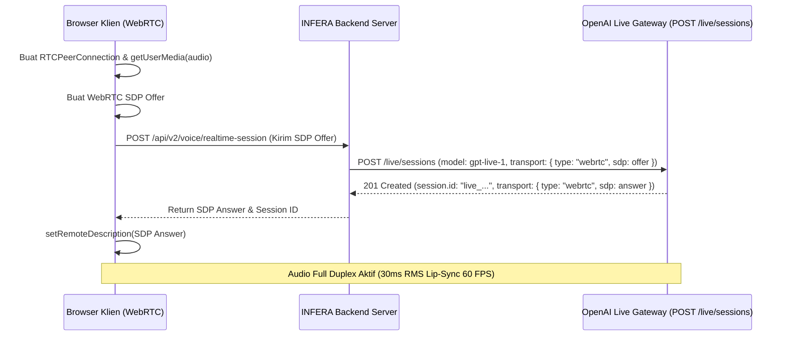

# Arsitektur GPT-Live & Responses Delegation

Dokumen ini mendokumentasikan implementasi arsitektur **GPT-Live** (`gpt-live-1`) dengan **Responses Delegation** pada platform **INFERA (Intelligent Fraud & Risk Analysis Agent)**. Ini merupakan standar generasi terbaru OpenAI untuk asisten percakapan suara dua arah (*full-duplex*) berkecepatan tinggi dengan pemisahan tugas cerdas (*intelligent task delegation*).

---

## 1. Konsep Dua Bagian (*The Two Parts Architecture*)

Berbeda dengan sistem suara tradisional yang menggabungkan seluruh instruksi hukum dan workflow bisnis ke dalam satu model suara, GPT-Live membagi beban kerja menjadi **dua lapisan terpisah**:

```
                                  KLIEN (Browser / WebRTC)
                                             │
                       Audio Full-Duplex (Opus) / Interupsi Spontan
                                             ▼
┌────────────────────────────────────────────────────────────────────────────────────────┐
│ 1. LAPISAN SUARA & PERCAKAPAN: GPT-Live (gpt-live-1)                                   │
│    - Mendengarkan mikrofon sambil berbicara bersamaan (Full-Duplex).                   │
│    - Menangani interupsi pengguna secara instan tanpa glitch.                          │
│    - Menjaga gaya bicara ramah dan empati (Avatar FERA BPJS Kesehatan).                │
│    - Memutuskan kapan harus mendelegasikan tugas analitis ke backend.                  │
└───────────────────────────────────────────┬────────────────────────────────────────────┘
                                            │
                                 DELEGATION (Konteks & Tugas)
                                            ▼
┌────────────────────────────────────────────────────────────────────────────────────────┐
│ 2. LAPISAN LOGIKA & ANALITIK: Backend Responses Delegation                             │
│    - Model Reasoning Cerdas: gpt-6-astra / gpt-6-luna.                                │
│    - Memegang seluruh instruksi hukum BPJS (Permenkes No. 16 Tahun 2019).              │
│    - Menjalankan 10 Tools Forensik (DSI, POR, Impossible Travel, dsb).                 │
│    - Menghasilkan kesimpulan audit terverifikasi dan mengembalikannya ke GPT-Live.     │
└────────────────────────────────────────────────────────────────────────────────────────┘
```

### Mengapa Pemisahan Ini Sangat Menguntungkan?
1. **Percakapan Tidak Pernah Membeku (*Never Freezes*):** Ketika auditor menanyakan data yang membutuhkan waktu pemrosesan database 1-2 detik, GPT-Live tetap dapat berbicara secara alami (*"Baik Dok, saya sedang memeriksa data klaim di RS Hermina..."*) dengan parameter `acknowledgement_delay_ms: 0` sementara backend menjalankan komputasi analitik.
2. **Kemandirian Model:** Model suara dioptimalkan murni untuk akustik dan intonasi bahasa Indonesia yang natural menggunakan suara kustom resmi FERA (`voice: "voice_6ae35f4fc2388191a0b2f21060b4e417"`, *FERA Natural Anime Indonesian*), sedangkan backend ditenagai oleh model reasoning berkapasitas tinggi (`gpt-6-astra` / `gpt-6-luna`) yang terhubung ke Remote MCP Server, Hosted Web Search, dan Vector Store Regulasi.
3. **Penanganan Interupsi Alami (*Graceful Interruption*):** Jika pengguna memotong pembicaraan FERA di tengah jalan, sistem audio langsung berhenti berbicara, dan aplikasi dapat memutuskan apakah komputasi analitik di backend tetap diselesaikan atau dibatalkan.

---

## 2. Mode Delegasi: Responses Delegation vs Client Delegation vs Decisions

| Aspek | Responses Delegation | Client Delegation | Decisions Delegation |
| :--- | :--- | :--- | :--- |
| **Penyedia Komputasi Backend** | OpenAI mengelola eksekusi model Responses | Server aplikasi klien mengelola eksekusi agen sendiri | Evaluasi pertanyaan deterministik via Decisions API |
| **Manajemen Konteks** | Otomatis dipertukarkan antara GPT-Live dan Responses | Klien mengatur konteks secara manual melalui event data channel | Menggunakan shared Decision items |
| **Penerapan Tools Forensik** | Tools didefinisikan pada sesi, dieksekusi via event tool call | Tools dieksekusi secara lokal di server backend aplikasi | Pertanyaan evaluasi: choice, predicate, score |
| **Kelebihan pada INFERA** | **Rekomendasi Utama:** Latensi ultra-rendah dan integrasi langsung dengan model reasoning `gpt-6-astra`. | Digunakan jika memerlukan pipeline orkestrasi kustom multi-agen lokal. | Digunakan untuk triase skor risiko cepat. |

---

## 3. Alur Koneksi WebRTC Sesi Pertama (`POST /live/sessions`)

Koneksi GPT-Live dibangun di atas standar WebRTC: media audio (Opus) ditransmisikan pada media track, sedangkan kontrol dan delegasi dikirimkan melalui WebRTC DataChannel.



---

## 4. Prompting untuk GPT-Live: Pemisahan Peran

Kunci keberhasilan implementasi GPT-Live adalah **menjaga prompt GPT-Live tetap ringkas** (maks. 16.384 token, immutable setelah sesi aktif), sementara instruksi bisnis yang panjang diletakkan pada backend delegation:

### A. Prompt Singkat pada GPT-Live (Conversation Layer):
```text
Anda adalah FERA, asisten virtual BPJS Kesehatan. 
Bicaralah dengan ramah, hangat, dan profesional dalam bahasa Indonesia.
Jika pengguna meminta pemeriksaan data klaim, investigasi kecurangan, atau penghitungan risiko, 
segera delegasikan tugas tersebut ke backend investigasi forensik dan sampaikan hasilnya setelah diterima.
```

### B. Prompt Rinci pada Backend Responses Delegation (Logic Layer):
```text
[TEMPORAL_ANCHOR]
- Current Local Time: Kamis, 29 Oktober 2026, 22:49:00 WIB (Asia/Jakarta, UTC+7)
- Current ISO-8601: 2026-10-29T15:49:00.000Z
- Active Fiscal Year: 2026
[/TEMPORAL_ANCHOR]

Anda adalah Engine Investigasi Forensik INFERA BPJS Kesehatan (FERA Reasoning Core).
Patuhi regulasi Permenkes No. 16 Tahun 2019, UU Kesehatan No. 17 Tahun 2023, dan Petunjuk Teknis Klaim INA-CBGs.
Gunakan tools terintegrasi:
1. INFERA MCP Server (/api/v2/mcp): 10 Tools Forensik (Impossible Travel, DSI, POR, serta rekomendasi tindakan penegakan hukum).
2. Hosted Web Search (kemkes.go.id, bpjs-kesehatan.go.id, who.int, jdih.kemkes.go.id) untuk surat edaran & update tarif baru.
3. Hosted File Search (vs_bpjs_regulations) untuk pasal regulasi resmi JKN.
Hitung skor risiko dan ajukan rekomendasi tindakan administratif (penangguhan kartu / surat peringatan) dengan persetujuan auditor manusia (Human-in-the-Loop).
```

---

## 5. Saluran Pemantauan Server (*Sideband WebSocket*) & Injeksi Runtime

Backend INFERA dapat menghubungkan koneksi server-side tambahan (**Sideband Connection**) ke `session.id` yang sama untuk melakukan kontrol runtime:
- **`session.thinking.append`:** Menyuntikkan konteks progres atau reasoning internal ke model Live tanpa disuarakan kepada pengguna.
- **`session.commentary.append`:** Menyuntikkan fakta audit baru dari database yang harus langsung diucapkan oleh model Live kepada auditor.
- **`session.instructions.append`:** Menyuntikkan aturan baru developer yang tersimpan permanen dalam riwayat percakapan.
- **`session.output_audio.fixture.play`:** Memutar audio darurat atau jingle pengumuman BPJS (mono PCM16LE 24kHz maks 30 detik) yang langsung menginterupsi suara model.

---

## 6. Efisiensi Biaya (*Cost Optimization*) pada Sesi Voice

Sesi suara GPT-Live ditagihkan berdasarkan durasi per detik, sedangkan model penalaran backend dan tool usage ditagihkan secara terpisah per token.

### Strategi Optimalisasi Biaya INFERA:
1. **VAD (Voice Activity Detection) Cerdas:** Audio hanya diproses saat pengguna aktif berbicara, memotong konsumsi token saat hening.
2. **Graceful Session Close:** Saat percakapan selesai atau pengguna menutup widget avatar, panggil fungsi penutup sesi formal untuk merekapitulasi total penggunaan dan memutus resource WebRTC.
3. **Caching Hasil Analitik:** Jika backend mendelegasikan kueri yang sebelumnya telah dihitung (misal profil faskes), `cacheService` mengembalikan hasil seketika tanpa memicu komputasi ulang.

---

## 7. Referensi Lanjutan
- Rincian parameter sesi dan transport: [**05. Live Sessions & Media Transport Reference**](./05-LIVE_SESSIONS_AND_MEDIA_TRANSPORT_REFERENCE.md)
- Kerangka evaluasi dan pengukuran latensi: [**02. Voice Agents Architecture & Evaluation**](./02-VOICE_AGENTS_ARCHITECTURE_AND_EVALUATION.md)
- Spesifikasi master asisten FERA: [**15. Spesifikasi Integrasi Sistem Asisten FERA**](./15-FERA_AGENT_INTEGRATION_SPECIFICATION.md)
