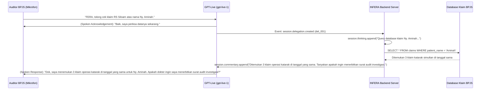

# Spesifikasi Lengkap: Live Sessions & Media Transport Reference

Dokumen ini mendokumentasikan spesifikasi teknis lengkap untuk endpoint pembuatan sesi live (**`POST /live/sessions`**) dan protokol **Primary WebSocket (`WS /v1/live/sessions`)** pada sistem **INFERA (Intelligent Fraud & Risk Analysis Agent)**. Dokumen ini menjadi pedoman arsitektur untuk negosiasi WebRTC/SIP, konfigurasi delegasi model (Responses vs Client vs Decisions), pengaturan audio full-duplex, dan kontrol injeksi runtime (`thinking`, `commentary`, `instructions`, serta `audio fixture`).

---

## 1. Arsitektur Transportasi Sesi Live

OpenAI Live Session mendukung dua metode inisiasi transport:
1. **WebRTC Media Transport (`POST /live/sessions`):**
   - Menggunakan SDP Offer/Answer untuk audio full-duplex dua arah (Opus) dengan latensi sub-detik (~300ms).
   - Data channel WebRTC digunakan untuk event kontrol dan refleksi data transkrip/tool calling.
2. **Primary WebSocket (`wss://api.openai.com/v1/live/sessions`):**
   - Koneksi WebSocket langsung dari backend dengan autentikasi `Authorization: Bearer $OPENAI_API_KEY`.
   - Mengalirkan audio PCM mentah (`audio/pcm` 16k/24k atau `audio/pcmu`/`audio/pcma` 8k) dan event kontrol dalam satu koneksi persisten.

```
┌──────────────────────────────────────────────────────────────────────────────────────────────────┐
│                                       PILIHAN TRANSPORT LIVE                                     │
├─────────────────────────────────────────────────┬────────────────────────────────────────────────┤
│           A. FRONTEND BROWSER / WEBRTC          │           B. BACKEND PERSISTENT WEBSOCKET      │
│            (POST /v1/live/sessions)             │            (WS /v1/live/sessions)              │
├─────────────────────────────────────────────────┼────────────────────────────────────────────────┤
│ 1. Client membuat SDP Offer                     │ 1. Backend buka wss://api.openai.com/v1/...    │
│ 2. Backend forward ke POST /live/sessions       │ 2. Backend kirim 'session.start'               │
│ 3. Server OpenAI mengembalikan SDP Answer       │ 3. Server OpenAI balas 'session.started'       │
│ 4. Koneksi P2P WebRTC langsung aktif            │ 4. Stream Base64 PCM16 via audio.append        │
└─────────────────────────────────────────────────┴────────────────────────────────────────────────┘
```

---

## 2. Endpoint Pembuatan Sesi: `POST /live/sessions`

Endpoint resmi untuk inisiasi sesi WebRTC terpadu atau panggilan keluar SIP (*outbound SIP call*).

- **Metode:** `POST`
- **URL:** `https://api.openai.com/v1/live/sessions`
- **Headers:**
  - `Authorization: Bearer $OPENAI_API_KEY`
  - `Content-Type: application/json`

### A. Struktur Body Parameter (`MediaSessionConfig`)

| Field | Tipe Data | Keterangan & Karakteristik |
| :--- | :--- | :--- |
| **`session.model`** | `string` (`"gpt-live-1"`) | **Wajib.** Model Live yang digunakan. Tidak boleh dikirim lewat URL query parameter. |
| **`session.audio.output.voice`** | `string` (31 opsi) | Suara avatar Live. Nilai default: `"marin"`. Bersifat **immutable** setelah sesi dimulai. Pilihan resmi: `"alloy"`, `"ash"`, `"ballad"`, `"beacon"`, `"bossa"`, `"brise"`, `"cedar"`, `"cinder"`, `"coral"`, `"delta"`, `"echo"`, `"flitz"`, `"gleam"`, `"harema"`, `"juni"`, `"marin"`, `"meridian"`, `"nira"`, `"noeul"`, `"nuri"`, `"quartz"`, `"ripple"`, `"sage"`, `"shida"`, `"shimmer"`, `"sillage"`, `"stone"`, `"tempo"`, `"verse"`, `"vesper"`, `"willow"`, atau `CustomVoice { id }`. |
| **`session.instructions`** | `string` (max 16.384 token) | Instruksi frontend untuk gaya percakapan, intonasi, persona (FERA), penanganan interupsi, dan aturan delegasi. Bersifat **immutable** setelah startup. |
| **`session.client.data_channel`** | `DataChannelConfig` | Izin keamanan frontend: `allowed_client_events` (misal: `["session.input_audio.mute"]` atau `"all"`) dan `allowed_server_events` (misal: `[{ type: "response.event", response_event: "output_text.delta" }]` atau `"all"`). |
| **`session.delegation`** | `ClientDelegation` \| `Responses` \| `Decisions` \| `null` | Pengelola tugas komputasi saat model Live memutuskan delegasi. |
| **`session.input`** | `Array<InitialItem>` | Riwayat teks awal sebelum startup (maks. 128 pesan, batas 8.192 token). |
| **`session.store`** | `boolean` (default: `false`) | Menyimpan sesi untuk keperluan forking atau pengunduhan rekaman audio. |
| **`session.triggers`** | `Array<DecisionTrigger>` (maks. 2) | Pemicu otomatis evaluasi keputusan pada `input_transcript.delta` atau `output_transcript.delta`. |
| **`transport`** | `Webrtc` \| `Sip` | Objek transport: `{ type: "webrtc", sdp: string }` atau `{ type: "sip", destination: string, trunk: {...} }`. |

---

## 3. Konfigurasi Delegasi: `session.delegation`

### A. Responses Delegation (`type: "responses"`) — Pilihan Utama INFERA
Model Live mendelegasikan tugas analitis berat ke model penalaran backend yang dikelola OpenAI:

```json
{
  "delegation": {
    "type": "responses",
    "acknowledgement_delay_ms": 0,
    "responses": {
      "model": "gpt-6-astra",
      "instructions": "Anda adalah Engine Forensik INFERA BPJS Kesehatan. Terapkan Permenkes No. 16 Tahun 2019. Jalankan 10 tools audit kecurangan klaim dan verifikasi anomali transaksi.",
      "max_output_tokens": 4096,
      "parallel_tool_calls": true,
      "reasoning": {
        "effort": "high",
        "summary": "auto"
      },
      "service_tier": "auto",
      "text": {
        "verbosity": "medium"
      },
      "tool_choice": "auto",
      "tools": [
        {
          "type": "function",
          "name": "audit_impossible_travel",
          "description": "Mendeteksi penggunaan satu kartu BPJS di dua faskes berjauhan dalam rentang waktu yang mustahil secara fisik.",
          "strict": true,
          "parameters": {
            "type": "object",
            "properties": {
              "nik": { "type": "string" },
              "lokasiA": { "type": "string" },
              "lokasiB": { "type": "string" },
              "selisihJam": { "type": "number" }
            },
            "required": ["nik", "lokasiA", "lokasiB", "selisihJam"],
            "additionalProperties": false
          }
        }
      ]
    }
  }
}
```

- **`acknowledgement_delay_ms` (0 - 800 ms):** Jeda waktu sebelum model Live secara otomatis mengucapkan pengakuan (*verbal acknowledgement*) seperti *"Baik, saya periksa datanya sebentar..."*. Nilai `0` berarti respon lisan spontan langsung diminta.

### B. Client Delegation (`type: "client"`)
Tugas didelegasikan ke backend server aplikasi mandiri. Sesi Live memancarkan event delegasi dan menunggu backend mengembalikan hasil via `session.commentary.append` atau `session.thinking.append`.

### C. Decisions Delegation (`type: "decisions"`)
Evaluasi cepat pertanyaan terstruktur berbasis tipe `choice`, `predicate`, atau `score` secara deterministik.

---

## 4. Primary WebSocket: Protokol Komunikasi `WS /v1/live/sessions`

Backend dapat terhubung langsung ke `wss://api.openai.com/v1/live/sessions` menggunakan API Key.

### Siklus Koneksi Primary WebSocket:
1. **Inisiasi Koneksi:** Handshake WebSocket dengan header `Authorization: Bearer $OPENAI_API_KEY`.
2. **Pesan Pertama Wajib (`session.start`):**
   ```json
   {
     "type": "session.start",
     "event_id": "evt_start_001",
     "session": {
       "model": "gpt-live-1",
       "instructions": "Anda adalah FERA, asisten virtual BPJS Kesehatan. Berikan penjelasan audit yang jelas dan empatik.",
       "audio": {
         "format": {
           "type": "audio/pcm",
           "rate": 24000
         },
         "output": {
           "voice": "voice_6ae35f4fc2388191a0b2f21060b4e417"
         }
       },
       "delegation": {
         "type": "responses",
         "responses": {
           "model": "gpt-6-astra",
           "instructions": "Logika investigasi klaim BPJS Kesehatan."
         }
       }
     }
   }
   ```
3. **Respon Konfirmasi Server (`session.started`):**
   ```json
   {
     "type": "session.started",
     "event_id": "event_started_1",
     "session": {
       "id": "live_67b3f912a",
       "expires_at": 1788307200,
       "status": "active",
       "model": "gpt-live-1"
     }
   }
   ```

---

## 5. Taksonomi Client Events pada Sesi Live

Berikut adalah seluruh perintah kontrol yang dapat dikirim oleh klien selama sesi aktif:

| Client Event | Payload Utama | Fungsi & Peran |
| :--- | :--- | :--- |
| **`session.start`** | `SessionConfig` | Menginisiasi konfigurasi sesi pada Primary WebSocket (hanya dikirim sekali di awal). |
| **`session.update`** | `SessionUpdateConfig` | Memperbarui konfigurasi delegasi atau triggers tanpa menutup sesi. *Model, audio format, dan suara bersifat immutable*. |
| **`session.input_audio.append`** | `{ audio: string }` | Mengirim chunk audio PCM mentah (Base64) tanpa header WAV ke model Live. |
| **`session.input_audio.mute`** | `{ event_id?: string }` | Meredam masukan audio mikrofon tanpa memutuskan koneksi sesi. Server membalas `session.input_audio.muted`. |
| **`session.input_audio.unmute`** | `{ event_id?: string }` | Mengaktifkan kembali mikrofon. Server membalas `session.input_audio.unmuted`. |
| **`session.output_audio.fixture.play`** | `{ audio: string }` | Memutar fixture audio darurat (misal: nada peringatan audit atau jingle BPJS). Audio harus mono PCM16LE 24 kHz (maks 30s). Bicara model langsung diinterupsi dan input dimatikan selama pemutaran. |
| **`session.instructions.append`** | `{ content: string, delegation_id?: string }` | Menambahkan instruksi developer baru secara dinamis (maks 500 token). Tetap tersimpan dalam histori kompresi konteks. |
| **`session.thinking.append`** | `{ content: string, delegation_id?: string }` | Menyuntikkan pemikiran internal/status progres (maks 500 token) tanpa diucapkan secara lisan ke pengguna. |
| **`session.commentary.append`** | `{ content: string, delegation_id?: string }` | Menyuntikkan informasi kontekstual yang **harus diucapkan** oleh model Live kepada pengguna (maks 500 token). |
| **`decision.create`** | `{ event_id: string }` | Menjalankan evaluasi keputusan terstruktur. |
| **`decision.item.create`** | `{ item: Message \| FunctionCall \| ... }` | Menambahkan item masukan untuk evaluasi keputusan mendatang. Mendukung `phase: "commentary" \| "final_answer"`. |
| **`decision.item.delete`** | `{ item_id: string }` | Menghapus item keputusan tertentu. |
| **`response.item.create`** | `{ item: EasyInputMessage \| FunctionCallOutput \| ... }` | Menambahkan item ke percakapan Responses backend (misal: menyuntikkan hasil eksekusi tool lokal). Mendukung `prompt_cache_breakpoint: { mode: "explicit", ttl: "30m" }`. |

---

## 6. Contoh Alur Skenario: Interupsi & Runtime Commentary Injection



---

## 7. Rangkuman Panduan Implementasi INFERA

1. **Gunakan WebRTC untuk Browser Klien:** Inisiasi via endpoint `POST /live/sessions` dengan SDP Offer dari browser, pasang `session.model = "gpt-live-1"` dan `voice = "voice_6ae35f4fc2388191a0b2f21060b4e417"` (*FERA Natural Anime Indonesian*) untuk persona FERA BPJS yang ramah, manis alami, dan jernih.
2. **Kunci Keamanan DataChannel:** Batasi `allowed_client_events` pada browser klien agar hanya event kontrol audio yang diizinkan (`mute`, `unmute`), mencegah manipulasi instruksi backend dari sisi klien publik.
3. **Pemisahan Instruksi Ketat:** Instruksi suara dan pembawaan santun diletakkan pada `session.instructions` Live, sedangkan aturan hukum Permenkes No. 16 Tahun 2019 dan 10 skema tools forensik diletakkan di `session.delegation.responses.instructions`.
4. **Respon Cepat via Verbal Acknowledgement:** Konfigurasikan `acknowledgement_delay_ms: 0` agar pengguna langsung mendengar respon pengakuan dari FERA begitu delegasi berjalan, memastikan latensi yang dirasakan (*perceived latency*) adalah nol.
