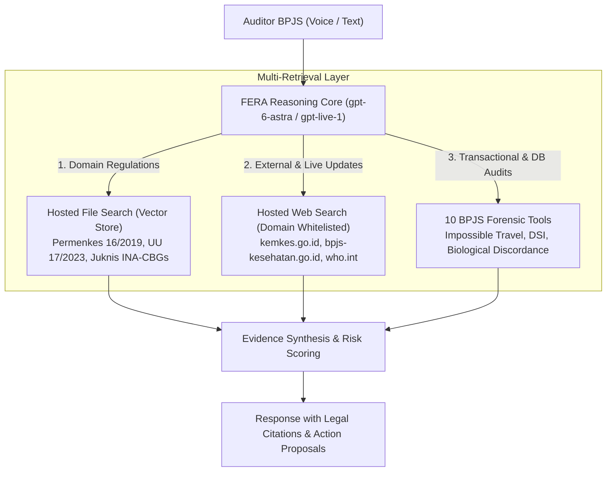

# 08. Hosted Web Search, File Search Vector Store, & Temporal Grounding

Dokumen ini menjelaskan spesifikasi arsitektur, konfigurasi teknis, dan implementasi integrasi **Hosted Web Search** dan **Hosted File Search (Vector Store)** pada sistem **INFERA** untuk asisten cerdas **FERA (Forensic & Evidence Reasoning Agent)**.

---

## 1. Arsitektur Multi-Retrieval FERA

Asisten FERA dirancang untuk melakukan investigasi anomali klaim BPJS Kesehatan dengan memadukan 3 lapis kapabilitas retrieval terintegrasi:



---

## 2. Hosted Web Search: Spesifikasi & Whitelisting Domain

### A. Konfigurasi Endpoint Responses API
Web search diintegrasikan langsung ke dalam skema tool Responses API (`POST /v1/responses`) atau konfigurasi delegasi GPT-Live:

```json
{
  "model": "gpt-6-astra",
  "tools": [
    {
      "type": "web_search",
      "filters": {
        "allowed_domains": [
          "kemkes.go.id",
          "bpjs-kesehatan.go.id",
          "sehatnegeriku.kemkes.go.id",
          "jdih.kemkes.go.id",
          "peraturan.bpk.go.id",
          "who.int"
        ]
      },
      "external_web_access": true
    }
  ]
}
```

### B. Keamanan & Whitelisting Domain Terpercaya
Untuk mencegah halusinasi dari blog non-kredibel atau forum publik, pencarian web dibatasi ketat ke domain resmi otoritas kesehatan dan perundang-undangan:
- **`kemkes.go.id` & `sehatnegeriku.kemkes.go.id`**: Surat Edaran (SE) Dirjen Yankes, Pedoman Nasional Praktik Kedokteran (PNPK), dan tarif INA-CBG terkini.
- **`bpjs-kesehatan.go.id`**: Peraturan Direksi BPJS Kesehatan, panduan klaim FKTP/FKRTL, regulasi Program Rujuk Balik (PRB).
- **`jdih.kemkes.go.id` & `peraturan.bpk.go.id`**: Verifikasi validitas Undang-Undang Kesehatan No. 17 Tahun 2023 dan Permenkes 16 Tahun 2019.
- **`who.int`**: Definisi standar ICD-10 klinis internasional dan penegakan diagnosis global.

### C. Alur Event Streaming Web Search (`stream: true`)
Ketika model memutuskan mencari informasi eksternal, event stream memancarkan progres pencarian secara transparan:
1. `response.tool_call_start` dengan tool `web_search`.
2. Action `search`: model mengeksekusi kueri penelusuran (misal: `"surat edaran kemenkes klaim katarak 2026"`).
3. Action `open_page`: membuka URL spesifik dari hasil pencarian teratas.
4. Action `find_in_page`: mengekstrak teks relevan di halaman tersebut.
5. Injeksi Anotasi `url_citation`:
   ```json
   {
     "type": "url_citation",
     "url": "https://jdih.kemkes.go.id/peraturan/pmk-16-2019",
     "title": "Permenkes No. 16 Tahun 2019 tentang Pencegahan Kecurangan JKN",
     "snippet": "Pasal 6 ayat (1): Indikasi manipulasi kartu peserta..."
   }
   ```

---

## 3. Hosted File Search & Vector Store Management

### A. Struktur Vector Store INFERA
Untuk dokumen internal regulasi yang statis dan berkapasitas besar, INFERA memanfaatkan OpenAI Vector Store API (`POST /v1/vector_stores`).

| Vector Store ID | Nama Koleksi | Isi Dokumen | Strategi Chunking |
| :--- | :--- | :--- | :--- |
| `vs_bpjs_regulations` | BPJS & Kemenkes Legal Corpus | Permenkes 16/2019, UU BPJS 24/2011, UU Kesehatan 17/2023 | 800 tokens, 150 token overlap |
| `vs_clinical_guidelines` | PNPK & INA-CBG Clinical Guidelines | Juknis Klaim INA-CBG, Kaidah Koding ICD-10 & ICD-9-CM | 500 tokens, 100 token overlap |
| `vs_fraud_typologies` | Tipologi Fraud & Studi Kasus Forensik | Kasus rujukan audit: ID sharing, upcoding, phantom billing | 600 tokens, 120 token overlap |

### B. Konfigurasi Tool `file_search`
```json
{
  "type": "file_search",
  "vector_store_ids": ["vs_bpjs_regulations", "vs_clinical_guidelines"],
  "max_num_results": 5,
  "ranking_options": {
    "ranker": "auto",
    "score_threshold": 0.65
  }
}
```

### C. Metadata Filtering
Pencarian dokumen mendukung filtering atribut berdasarkan kategori dokumen dan tahun penerbitan:
```json
{
  "filter": {
    "type": "and",
    "filters": [
      { "type": "eq", "key": "category", "value": "permenkes" },
      { "type": "gte", "key": "year", "value": 2019 }
    ]
  }
}
```

---

## 4. Sinkronisasi Waktu Nyata (`time now`) pada Retrieval

Salah satu kelemahan fatal sistem AI regulatori adalah **temporal disalignment** (kebingungan menentukan apakah suatu aturan sudah kedaluwarsa, atau apakah suatu klaim melanggar jangka waktu tertentu).

### A. Format Injeksi Temporal Dinamis
Pada setiap inisialisasi sesi GPT-Live (`POST /live/sessions`) maupun pemanggilan Responses API, server secara otomatis menginjeksi blok waktu presisi ke dalam *system prompt / developer instructions*:

```typescript
const now = new Date();
const timeContext = `
[TEMPORAL_ANCHOR]
- Current Local Time: ${now.toLocaleDateString('id-ID', { weekday: 'long', year: 'numeric', month: 'long', day: 'numeric', timeZone: 'Asia/Jakarta' })} pukul ${now.toLocaleTimeString('id-ID', { timeZone: 'Asia/Jakarta' })} WIB
- Current ISO-8601: ${now.toISOString()}
- Timezone: Asia/Jakarta (UTC+7, WIB)
- Epoch Milliseconds: ${now.getTime()}
- Active Fiscal Year: ${now.getFullYear()}
[/TEMPORAL_ANCHOR]
`;
```

### B. Implikasi Hukum & Audit terhadap Anchor Waktu
Dengan injeksi temporal ini, FERA dapat mengevaluasi:
1. **Rule Readmisi 14 Hari (Permenkes 16/2019)**: Menghitung selisih $\Delta t = |t_{\text{admission}} - t_{\text{discharge_prior}}|$. Jika $\Delta t \le 14\text{ hari}$ untuk diagnosis primer serumpun, dicatat sebagai potensi unbundling readmisi rawat inap.
2. **Cooling-Off Period Alat Kesehatan**:
   - Kacamata: $\ge 2\text{ tahun}$ sejak klaim terakhir.
   - Alat Bantu Dengar: $\ge 5\text{ tahun}$ sejak klaim terakhir.
3. **Masa Berlaku Regulasi**: FERA memprioritaskan UU No. 17 Tahun 2023 (Omnibus Law Kesehatan) atas undang-undang kesehatan sebelumnya yang telah dicabut.
4. **Verifikasi Kecepatan Impossible Travel**: Mengukur kecepatan perjalanan fisik $v = \frac{\Delta s}{\Delta t}$ antar-faskes berdasarkan selisih waktu log klaim relatif terhadap waktu nyata.

---

## 5. Integrasi Terpadu: Web Search + File Search + 10 Forensic Tools

Berikut adalah arsitektur panggilan terpadu pada `OpenAiChatService` API v2 yang menggabungkan seluruh kapabilitas retrieval dan audit:

```typescript
// Unified Tools Declaration for Responses API
const activeTools = [
  // 1. Hosted Web Search (Whitelisted)
  {
    type: 'web_search' as const,
    filters: {
      allowed_domains: [
        'kemkes.go.id',
        'bpjs-kesehatan.go.id',
        'sehatnegeriku.kemkes.go.id',
        'jdih.kemkes.go.id',
        'peraturan.bpk.go.id'
      ]
    },
    external_web_access: true
  },
  // 2. Hosted File Search (Vector Stores)
  {
    type: 'file_search' as const,
    vector_store_ids: [
      process.env.OPENAI_VECTOR_STORE_REGULATIONS || 'vs_bpjs_regulations'
    ]
  },
  // 3. 10 BPJS Forensic Tools
  ...INFERA_TOOL_DEFINITIONS.map(t => ({
    type: 'function' as const,
    name: t.function.name,
    description: t.function.description,
    parameters: t.function.parameters
  }))
];
```

---

## 6. Penanganan Output & Kutipan pada Frontend

Pada frontend (`apps/web`), anotasi kutipan (`url_citation` dan `file_citation`) diparsing dan dirender sebagai badge interaktif:

```tsx
// Komponen Badge Kutipan Regulasi & Web
export const CitationBadge = ({ citation }: { citation: CitationItem }) => {
  if (citation.type === 'url_citation') {
    return (
      <a
        href={citation.url}
        target="_blank"
        rel="noopener noreferrer"
        className="inline-flex items-center gap-1.5 px-2.5 py-1 rounded-md text-xs font-medium bg-emerald-500/10 text-emerald-400 border border-emerald-500/20 hover:bg-emerald-500/20 transition-colors"
      >
        <Globe className="w-3 h-3" />
        <span>{citation.title || new URL(citation.url).hostname}</span>
      </a>
    );
  }

  return (
    <span className="inline-flex items-center gap-1.5 px-2.5 py-1 rounded-md text-xs font-medium bg-cyan-500/10 text-cyan-400 border border-cyan-500/20">
      <FileText className="w-3 h-3" />
      <span>{citation.filename} (hal. {citation.page})</span>
    </span>
  );
};
```

---

## 7. Rangkuman & Best Practices

1. **Prioritas Retrieval**: Dokumen Vector Store internal (`file_search`) diprioritaskan untuk regulasi baku JKN, sedangkan `web_search` digunakan untuk pengumuman terkini, surat edaran baru, atau verifikasi berita kasus eksternal.
2. **Determinisme & Cache**: Hasil kueri pencarian regulasi yang bersifat referensial di-cache menggunakan SHA-256 key untuk menjaga kecepatan respons dan menghemat kuota token.
3. **Audit Trail**: Setiap temuan fraud yang merujuk pada regulasi web atau dokumen internal wajib menyertakan URL atau nomor pasal yang dapat diverifikasi oleh auditor manusia (*Human-in-the-Loop*).
