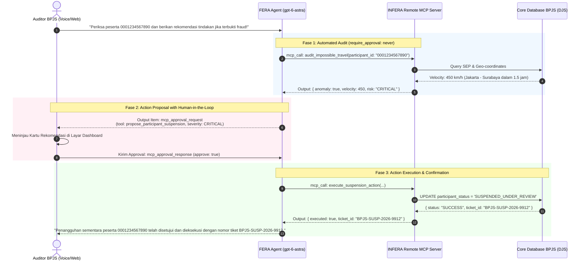

# 09. Model Context Protocol (MCP) & 10 Forensic Action Tools

Dokumen ini mendokumentasikan secara komprehensif integrasi **Model Context Protocol (MCP)** dan **10 Forensic Action Tools** pada sistem **INFERA** untuk asisten cerdas **FERA (Forensic & Evidence Reasoning Agent)**.

Spesifikasi ini mencakup integrasi Remote MCP Server pada OpenAI Responses API (`POST /v1/responses`), sistem persetujuan manusia (*Human-in-the-Loop Approvals*), Secure MCP Tunnel, serta integrasi pemanggilan fungsi pada protokol WebRTC GPT-Live.

---

## 1. Arsitektur Terintegrasi MCP & Human-in-the-Loop (HITL)

Asisten FERA bukan sekadar chatbot yang menjawab pertanyaan, melainkan **Forensic & Enforcement Agent** yang mampu mendeteksi kecurangan, merekomendasikan tindakan penegakan hukum, dan mengeksekusi aksi administratif melalui protokol terstandar **MCP**.



---

## 2. Klasifikasi 10 Forensic Tools: Read-Only vs Action Proposals

Untuk memastikan keselamatan operasional (*safety & governance*), tools INFERA dibagi secara tegas menjadi dua tingkat otoritas:

| No | Nama Tool MCP | Kategori Otoritas | Kebijakan Approval | Deskripsi & Parameter Kunci |
| :---: | :--- | :---: | :---: | :--- |
| **1** | `audit_impossible_travel` | **Read-Only / Audit** | `require_approval: "never"` | Mengukur kecepatan perpindahan fisik $v = \frac{\Delta s}{\Delta t}$ antar-faskes. Parameter: `participant_id`, `audit_date`. |
| **2** | `audit_doctor_shopping` | **Read-Only / Audit** | `require_approval: "never"` | Menghitung indeks DSI ($\ge 0.5$) dan frekuensi kunjungan keluhan serupa. Parameter: `participant_id`, `window_days`. |
| **3** | `audit_prescription_overlap` | **Read-Only / Audit** | `require_approval: "never"` | Menghitung rasio Prescription Overlap Ratio (POR $> 140\%$) obat kronis PRB. Parameter: `participant_id`, `drug_code`. |
| **4** | `audit_cooling_off_violation`| **Read-Only / Audit** | `require_approval: "never"` | Memverifikasi masa tunggu kacamata ($< 2\text{ tahun}$) dan alkes ($< 5\text{ tahun}$). Parameter: `participant_id`, `device_type`. |
| **5** | `calculate_risk_score` | **Read-Only / Audit** | `require_approval: "never"` | Menghitung skor risiko komprehensif (0-100) dan level keparahan (CRITICAL, HIGH, MEDIUM, LOW). |
| **6** | `search_regulations_rag` | **Read-Only / Legal** | `require_approval: "never"` | Mengambil dasar hukum Permenkes 16/2019, UU Kesehatan 17/2023, KUHP 263. |
| **7** | `propose_participant_suspension` | **Sensitive Action** | `require_approval: "always"` | **Rekomendasi penangguhan sementara kepesertaan JKN** atas indikasi diskordansi biologis atau peminjaman kartu. |
| **8** | `propose_warning_letter` | **Sensitive Action** | `require_approval: "always"` | **Penerbitan draft surat klarifikasi / peringatan resmi (SP-1)** kepada peserta atau manajemen faskes. |
| **9** | `propose_case_review` | **Sensitive Action** | `require_approval: "always"` | **Eskalasi ke Sidang Ad-Hoc Pencegahan Kecurangan DJS** dengan estimasi kerugian finansial. |
| **10**| `dispatch_supervisor_alert` | **Sensitive Action** | `require_approval: "always"` | **Pengiriman notifikasi darurat** ke Kepala Cabang BPJS / Tim Investigasi melalui konektor Teams/Email. |

---

## 3. Konfigurasi Remote MCP Server pada Responses API

### A. Format Deklarasi MCP Tools
Pada pemanggilan `client.responses.create()`, tools MCP dideklarasikan dengan tipe `mcp`:

```typescript
import OpenAI from 'openai';
import { env } from '../config/env.js';

const client = new OpenAI({ apiKey: env.OPENAI_API_KEY });

const response = await client.responses.create({
  model: 'gpt-6-astra',
  tools: [
    {
      type: 'mcp',
      server_label: 'infera_forensic_server',
      server_description: 'INFERA BPJS Health Fraud Investigation and Action Proposal MCP Server.',
      server_url: env.MCP_SERVER_URL || 'https://api.infera.bpjs.id/mcp',
      // Skema granular approval: audit otomatis jalan seketika, aksi penindakan wajib approval manusia
      require_approval: {
        never: {
          tool_names: [
            'audit_impossible_travel',
            'audit_doctor_shopping',
            'audit_prescription_overlap',
            'audit_cooling_off_violation',
            'calculate_risk_score',
            'search_regulations_rag'
          ]
        }
      }
      // Tool di luar daftar "never" otomatis mewajibkan persetujuan manusia ("always")
    }
  ],
  input: 'Analisis anomali klaim peserta 0001234567890 dan rekomendasikan penangguhan jika risiko kritis.'
});
```

### B. Output `mcp_list_tools`
Pada giliran pertama, server OpenAI menghubungi endpoint MCP untuk menginspeksi seluruh tools yang tersedia:
```json
{
  "id": "mcpl_68a6102a4968819c8177b05584dd627b0679e572a900e618",
  "type": "mcp_list_tools",
  "server_label": "infera_forensic_server",
  "tools": [
    {
      "name": "propose_participant_suspension",
      "description": "Mengajukan penangguhan sementara kartu peserta JKN atas temuan fraud berat.",
      "input_schema": {
        "type": "object",
        "properties": {
          "participant_id": { "type": "string" },
          "participant_name": { "type": "string" },
          "reason": { "type": "string" },
          "severity": { "type": "string", "enum": ["CRITICAL", "HIGH"] },
          "legal_basis": { "type": "string" }
        },
        "required": ["participant_id", "participant_name", "reason", "severity"]
      }
    }
  ]
}
```

---

## 4. Siklus Persetujuan Manusia (*Human-in-the-Loop Approval Workflow*)

### A. Deteksi `mcp_approval_request` oleh Backend
Ketika FERA memutuskan bahwa suatu kasus memenuhi syarat untuk penindakan, model memancarkan output bertipe `mcp_approval_request`:

```json
{
  "id": "mcpr_682d498e3bd4819196a0ce1664f8e77b04ad1e533afccbfa",
  "type": "mcp_approval_request",
  "name": "propose_participant_suspension",
  "server_label": "infera_forensic_server",
  "arguments": "{\"participant_id\":\"0001234567890\",\"participant_name\":\"Budi Santoso\",\"reason\":\"Impossible travel velocity 450 km/h antara Jakarta dan Surabaya\",\"severity\":\"CRITICAL\",\"legal_basis\":\"Permenkes 16/2019 Pasal 6 Ayat 1\"}"
}
```

Backend mengemas event ini ke dalam SSE stream ke frontend sebagai `action_proposal`:
```json
data: {"type":"ACTION_PROPOSAL","data":{"approvalRequestId":"mcpr_682d498e3bd4819196a0ce1664f8e77b04ad1e533afccbfa","toolName":"propose_participant_suspension","arguments":{"participant_id":"0001234567890","participant_name":"Budi Santoso","reason":"Impossible travel velocity 450 km/h antara Jakarta dan Surabaya","severity":"CRITICAL","legal_basis":"Permenkes 16/2019 Pasal 6 Ayat 1"}}}
```

### B. Tampilan Antarmuka Persetujuan di Frontend (`apps/web`)
Auditor melihat kartu interaktif di dashboard:
```tsx
// Komponen ActionApprovalCard.tsx
export const ActionApprovalCard = ({
  proposal,
  onApprove,
  onReject
}: {
  proposal: ActionProposal;
  onApprove: (id: string) => void;
  onReject: (id: string) => void;
}) => (
  <div className="p-4 rounded-xl border border-rose-500/30 bg-rose-950/20 backdrop-blur-md">
    <div className="flex items-center justify-between mb-2">
      <span className="px-2 py-0.5 text-xs font-bold rounded bg-rose-500/20 text-rose-300 border border-rose-500/40">
        REKOMENDASI TINDAKAN: {proposal.toolName}
      </span>
      <span className="text-xs text-rose-400 font-mono">SEVERITY: {proposal.arguments.severity}</span>
    </div>
    <p className="text-sm text-slate-200 mb-1">
      <strong>Target:</strong> {proposal.arguments.participant_name} ({proposal.arguments.participant_id})
    </p>
    <p className="text-sm text-slate-300 mb-2">
      <strong>Alasan:</strong> {proposal.arguments.reason}
    </p>
    <p className="text-xs text-slate-400 mb-4">
      <strong>Dasar Hukum:</strong> {proposal.arguments.legal_basis}
    </p>
    <div className="flex gap-2">
      <button
        onClick={() => onApprove(proposal.approvalRequestId)}
        className="px-4 py-1.5 text-xs font-semibold rounded-lg bg-emerald-600 hover:bg-emerald-500 text-white shadow-lg transition"
      >
        Setujui Tindakan
      </button>
      <button
        onClick={() => onReject(proposal.approvalRequestId)}
        className="px-4 py-1.5 text-xs font-semibold rounded-lg bg-slate-800 hover:bg-slate-700 text-slate-300 border border-slate-700 transition"
      >
        Tolak / Batalkan
      </button>
    </div>
  </div>
);
```

### C. Eksekusi Chaining via `mcp_approval_response`
Saat auditor mengklik tombol **"Setujui Tindakan"**, klien mengirimkan permintaan ke API v2, yang kemudian meneruskannya ke OpenAI Responses API dengan merujuk pada `previous_response_id`:

```typescript
// Resuming conversation post-approval
const resumeResponse = await client.responses.create({
  model: 'gpt-6-astra',
  previous_response_id: lastResponseId,
  input: [
    {
      type: 'mcp_approval_response',
      approval_request_id: 'mcpr_682d498e3bd4819196a0ce1664f8e77b04ad1e533afccbfa',
      approve: true
    }
  ],
  tools: mcpToolsConfiguration
});
```

Model secara otomatis mengeksekusi tool tersebut pada MCP server dan mengalirkan hasil eksekusinya (`mcp_call`) kembali ke auditor melalui teks dan suara avatar FERA.

---

## 5. Implementasi INFERA Local / On-Premise MCP Server

Untuk lingkungan faskes atau server database internal BPJS yang berada di balik firewall, INFERA mendukung dua mode konektivitas:

### A. Endpoint Streamable HTTP / SSE MCP Server
Server Express INFERA menyediakan endpoint resmi `/mcp` yang mengimplementasikan spesifikasi Model Context Protocol:
```typescript
import { Router } from 'express';

export const mcpRouter = Router();

mcpRouter.post('/mcp', async (req, res) => {
  const { jsonrpc, method, params, id } = req.body;

  if (method === 'tools/list') {
    return res.json({
      jsonrpc: '2.0',
      id,
      result: {
        tools: INFERA_MCP_TOOLS_MANIFEST
      }
    });
  }

  if (method === 'tools/call') {
    const { name, arguments: args } = params;
    const result = await executeForensicTool(name, args);
    return res.json({
      jsonrpc: '2.0',
      id,
      result: {
        content: [
          {
            type: 'text',
            text: JSON.stringify(result)
          }
        ]
      }
    });
  }

  return res.status(404).json({ error: 'Method not found' });
});
```

### B. Secure MCP Tunnel untuk Faskes On-Premise
Jika database RSUD/FKRTL berada di jaringan privat, gunakan binary resmi `openai-tunnel`:
```bash
# Menjalankan tunnel aman dari server faskes ke OpenAI
openai-tunnel --local-url http://localhost:8080/mcp --label rsud_internal_audit
```
Pada Responses API, tentukan parameter `tunnel_id`:
```json
{
  "type": "mcp",
  "server_label": "rsud_internal_audit",
  "tunnel_id": "tun_68a91b2c4e...",
  "require_approval": "always"
}
```

---

## 6. Sinergi MCP dengan GPT-Live WebRTC Voice

Ketika pengguna berinteraksi melalui suara full-duplex WebRTC:
1. Model suara (`gpt-live-1`) menggunakan suara kustom `voice_6ae35f4fc2388191a0b2f21060b4e417` (*FERA Natural Anime Indonesian*).
2. Delegasi penalaran analitis dialihkan ke model `gpt-6-astra` dengan konfigurasi tools MCP.
3. Begitu FERA mengidentifikasi indikasi kecurangan, FERA berbicara secara lisan:
   > *"Dari hasil audit perjalanan impossible travel peserta Hendra Wijaya, terdeteksi kecepatan 450 kilometer per jam antara Jakarta dan Surabaya. Saya telah mengajukan kartu rekomendasi penangguhan sementara di layar Anda. Apakah Anda menyetujui tindakan ini?"*
4. Auditor dapat menjawab secara lisan *"Ya, setujui"* atau menekan tombol di UI. Tindakan langsung dieksekusi secara instan dan aman!
