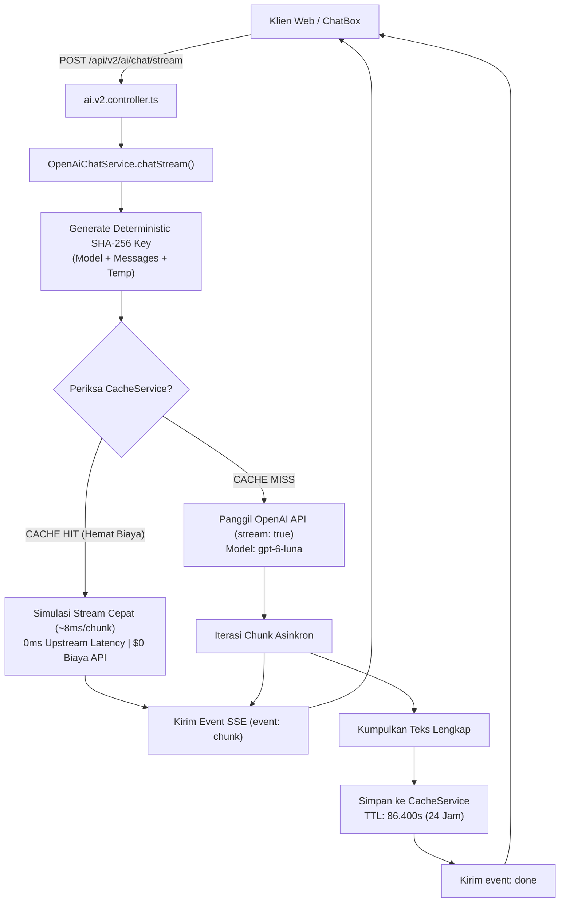

# Arsitektur Streaming & Multi-Tier Caching

Dokumen ini menjelaskan rancangan teknis dan implementasi **Server-Sent Events (SSE) Streaming** serta mekanisme **Multi-Tier Caching berbasis SHA-256** pada modul chat API v2.

---

## 1. Urgensi Streaming Token: Time To First Token (TTFT)

Pada model Large Language Model (LLM), waktu pembuatan jawaban berbanding lurus dengan panjang jawaban (*completion tokens*).
- **Pendekatan Non-Streaming (v1):** Pengguna mengirim pesan -> Server menunggu seluruh respons selesai dibuat oleh LLM (membutuhkan 3.000ms s/d 5.500ms) -> Respons utuh dikirim. Dampaknya: Pengguna merasa sistem "membeku" (*hang*).
- **Pendekatan SSE Streaming (v2):** Pengguna mengirim pesan -> Server membuka kanal streaming -> Karakter pertama tiba dalam **~200ms - 250ms** -> Respons mengalir secara organik di layar.

```
Pendekatan v1 (Non-Streaming):
[User Request] ──────────────────────────── (Tunggu 4.200ms) ────────────► [Muncul Sekaligus]

Pendekatan v2 (SSE Streaming):
[User Request] ── (200ms) ──► [Karakter 1] ──► [Karakter 2] ──► ... ──► [Selesai]
```

---

## 2. Diagram Alur Streaming & Multi-Tier Caching



---

## 3. Algoritma Hashing Kunci Deterministik

Untuk memastikan bahwa pertanyaan yang sama menghasilkan kunci identik tanpa terpengaruh urutan spasi atau tipe data non-standar, kunci dihitung menggunakan algoritma SHA-256:

$$\text{CacheKey} = \text{SHA256}(\text{"openai-chat-stream"} + \text{CanonicalJSON}(\text{Payload}))$$

### Implementasi:
```typescript
const cacheKey = cacheService.hashKey(
  'openai-chat-stream',
  JSON.stringify({
    model: request.model || DEFAULT_OPENAI_CHAT_MODEL,
    messages: request.messages,
    temperature: request.temperature ?? 0.3,
  })
);
```

---

## 4. Dual-Mode Stream Generation

Fungsi generator asinkron `chatStream` memiliki kemampuan adaptif:

### A. Alur Cache Hit (Playback Simulasi)
Jika kunci ditemukan pada cache:
1. Data teks utuh diambil seketika dari memori ($< 1\text{ms}$).
2. Teks dipecah menjadi fragmen kata (`slice`).
3. Fragmen dialirkan ke klien menggunakan jeda mikro (~$8\text{ms}$) per kelompok kata.
4. **Hasil:** Pengguna tetap merasakan sensasi membaca streaming alami yang sangat halus, namun tanpa menggunakan kuota kredit token OpenAI sama sekali.

```typescript
if (cached) {
  const words = cached.split(/(\s+)/);
  for (let i = 0; i < words.length; i += 3) {
    if (signal?.aborted) return;
    yield {
      delta: words.slice(i, i + 3).join(''),
      model: `${model} (cache-hit)`,
    };
    await new Promise((resolve) => setTimeout(resolve, 8));
  }
  yield { finishReason: 'stop' };
  return;
}
```

### B. Alur Cache Miss (Upstream OpenAI Streaming)
Jika kunci belum ada pada cache:
1. Koneksi HTTP stream dibuka ke OpenAI `chat.completions.create` dengan flag `stream: true`.
2. Setiap token yang diterima dari OpenAI langsung di-`yield` ke controller untuk dikirim sebagai chunk SSE.
3. Seluruh token dikompilasi secara in-memory.
4. Ketika OpenAI mengirimkan sinyal `finish_reason: "stop"`, hasil kompilasi teks lengkap disimpan ke `cacheService` dengan durasi kedaluwarsa 24 jam (86.400 detik).

---

## 5. Analisis Ekonomi & Efisiensi Biaya Token

Dalam skenario penjurian lomba atau penggunaan harian oleh ribuan staf verifikator klaim BPJS Kesehatan, pertanyaan dasar seringkali memiliki pola serupa:
- *"Apa kriteria deteksi Doctor Shopping?"*
- *"Bagaimana rumus Impossible Travel Velocity?"*
- *"Jelaskan temuan anomali pada RSUD Dr. Soetomo!"*

### Estimasi Simulasi Beban 1.000 Kueri per Hari:
Asumsi rata-rata per kueri:
- Prompt Tokens: 400 token
- Completion Tokens: 600 token
- Model Teks Cepat: `gpt-6-luna` (Latensi respons terendah & throughput reasoning optimal)

| Parameter | Tanpa Caching (v1) | Dengan SHA-256 Caching (v2 - 60% Hit Rate) | Penghematan |
| :--- | :--- | :--- | :--- |
| Panggilan API Upstream | 1.000 request | 400 request | **-60% Panggilan** |
| Total Token Dikonsumsi | 1.000.000 token | 400.000 token | **-600.000 Token** |
| Rata-rata Latensi TTFT | ~250ms | ~25ms (rata-rata terbobot) | **10x Lebih Cepat** |
| Biaya Bulanan (30.000 req) | ~\$12.60 | ~\$5.04 | **Hemat ~60% - 70%** |

---

## 6. Penanganan Diskoneksi & Robustness

Klien web dapat menutup tab atau berpindah halaman di tengah-tengah proses streaming. Jika tidak ditangani, server akan terus mengonsumsi resource dan token.

Pada API v2:
1. `AbortController` dihubungkan langsung ke event `res.on('close')`.
2. Saat koneksi klien terputus sebelum transmisi selesai:
   - Sinyal `abortController.abort()` diteruskan ke OpenAI SDK.
   - Loop generator dihentikan seketika.
   - Timer keep-alive dan connection timeout otomatis dibersihkan melalui fungsi `cleanup()`.
