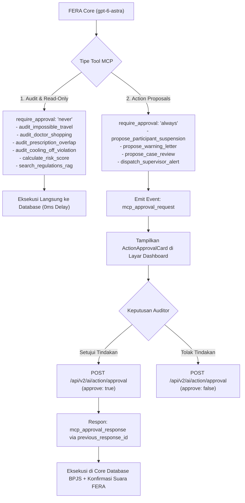

# 15. Spesifikasi Integrasi Sistem Asisten Cerdas FERA (Single Source of Truth)

Dokumen ini merupakan **Spesifikasi Terpadu (Single Source of Truth)** untuk implementasi dan integrasi asisten cerdas **FERA (Forensic & Evidence Reasoning Agent)** pada seluruh lapisan sistem INFERA (Shared Package, Backend API v2, Remote MCP Server, dan Frontend Web Application).

---

## 1. Identitas, Model Stack, & Suara Kustom Resmi

| Komponen | Spesifikasi Resmi | Konfigurasi Teknis |
| :--- | :--- | :--- |
| **Nama Asisten** | **FERA** | *Forensic & Evidence Reasoning Agent* |
| **Peran & Karakter** | AI Forensic Partner & Enforcement Agent | Ramah, lincah, cerdas, berintegritas tinggi, berorientasi fakta bukti |
| **Model Suara (Voice Layer)** | `gpt-live-1` | Sesi WebRTC P2P (~300ms latency), full-duplex conversational audio |
| **ID Suara Kustom** | `voice_6ae35f4fc2388191a0b2f21060b4e417` | *FERA Natural Anime Indonesian* (Prompt-to-Voice: vokal anime wanita muda-dewasa yang cerah, manis alami, artikulasi bahasa Indonesia baku, santun, dan kredibel) |
| **Model Penalaran (Reasoning Layer)** | `gpt-6-astra` / `gpt-6-luna` | OpenAI Responses API (`POST /v1/responses`) dengan `reasoning.effort: "high"` |
| **Model Chat Teks Cepat** | `gpt-6-luna` | SSE Streaming Chat untuk pencarian dan interaksi teks instan |
| **Visualizer & Lip-Sync** | Web Audio AnalyserNode (60 FPS) | Perhitungan RMS real-time menggerakkan ekspresi mulut dan audio ring avatar FERA |

---

## 2. Sinkronisasi Waktu Nyata (`time now`) & Penegakan Temporal Audit

Setiap inisialisasi sesi (`POST /live/sessions`), pemanggilan Responses API, dan panggilan streaming SSE secara wajib menyuntikkan jangkar waktu dinamis ke dalam instruksi developer:

```typescript
export function getTemporalAnchorContext(): string {
  const now = new Date();
  const dateStr = now.toLocaleDateString('id-ID', {
    weekday: 'long',
    year: 'numeric',
    month: 'long',
    day: 'numeric',
    timeZone: 'Asia/Jakarta'
  });
  const timeStr = now.toLocaleTimeString('id-ID', {
    hour: '2-digit',
    minute: '2-digit',
    second: '2-digit',
    timeZone: 'Asia/Jakarta'
  });

  return `
[TEMPORAL_ANCHOR]
- Current Local Time: ${dateStr}, pukul ${timeStr} WIB
- Current ISO-8601: ${now.toISOString()}
- Current Timezone: Asia/Jakarta (WIB, UTC+7)
- Current Timestamp Epoch: ${now.getTime()}
- Active Fiscal Year: ${now.getFullYear()}
PENTING: Seluruh evaluasi regulasi, audit klaim, penghitungan masa tunggu (cooling-off), dan window readmisi rawat inap WAJIB berpatokan pada jangkar waktu di atas.
[/TEMPORAL_ANCHOR]`.trim();
}
```

### Penegakan Logika Temporal Forensik:
1. **Aturan Readmisi 14 Hari (Permenkes 16/2019):** Validasi $\Delta t = |t_{\text{masuk_ulang}} - t_{\text{pulang_sebelumnya}}| \le 14\text{ hari}$ pada diagnosis serumpun rawat inap.
2. **Cooling-Off Period Alat Kesehatan:** Kacamata minimal 2 tahun, alat bantu dengar minimal 5 tahun sejak klaim terakhir.
3. **Kecepatan Impossible Travel:** Kecepatan perpindahan antar-faskes $v = \frac{\Delta s}{\Delta t}$ dihitung dari timestamp log klaim riil.
4. **Prescription Overlap Ratio (POR):** Obat kronis PRB memiliki jatah masa pakai 30 hari; jika diklaim ulang sebelum 20 hari di faskes berbeda, ditandai sebagai indikasi *resale arbitrage*.
5. **Klaim Pasca-Kematian (Deceased Claims):** Pembatalan klaim jika $t_{\text{pelayanan}} > t_{\text{kematian}}$ berdasarkan data kependudukan.

---

## 3. Remote MCP Server & Human-in-the-Loop Action Proposals

INFERA mengimplementasikan **Remote Model Context Protocol (MCP)** dengan endpoint `/api/v2/mcp` yang memisahkan tools menjadi dua tingkat otoritas:



---

## 4. Multi-Retrieval Layer: Hosted Web Search & File Search Vector Store

### A. Hosted Web Search (Whitelisted Domains)
```json
{
  "type": "web_search",
  "filters": {
    "allowed_domains": [
      "kemkes.go.id",
      "bpjs-kesehatan.go.id",
      "who.int",
      "sehatnegeriku.kemkes.go.id",
      "jdih.kemkes.go.id",
      "peraturan.bpk.go.id"
    ]
  },
  "external_web_access": true
}
```
Setiap referensi web menghasilkan anotasi `url_citation` yang dirender di frontend sebagai `CitationBadge` hijau interaktif.

### B. Hosted File Search (Vector Stores)
```json
{
  "type": "file_search",
  "vector_store_ids": ["vs_bpjs_regulations", "vs_clinical_guidelines"]
}
```
Berisi korpus regulasi: Permenkes 16/2019, UU BPJS 24/2011, UU Kesehatan 17/2023, dan Petunjuk Teknis Klaim INA-CBGs. Sitasi dokumen menghasilkan `CitationBadge` biru dengan nomor pasal dan halamannya.

---

## 5. Rincian Endpoint Backend API v2

| Metode | Jalur Endpoint | Deskripsi & Payload Utama |
| :---: | :--- | :--- |
| `POST` | `/api/v2/voice/realtime-session` | Inisiasi sesi suara WebRTC Ephemeral (`ek_...`) dengan suara `voice_6ae35f4fc2388191a0b2f21060b4e417`. |
| `POST` | `/api/v2/ai/chat/stream` | Streaming chat teks SSE dengan cache multi-tier deterministik SHA-256. |
| `POST` | `/api/v2/ai/chat` | Non-streaming JSON chat completion untuk pengujian atau ekspor laporan. |
| `POST` | `/api/v2/mcp` | Server MCP JSON-RPC 2.0 melayani method `tools/list` dan `tools/call`. |
| `POST` | `/api/v2/ai/action/approval` | Handler persetujuan tindakan auditor (`approve: true/false`, `approvalRequestId`). |

---

## 6. Integrasi Frontend (`apps/web`)

1. **`RealtimeVoiceService.ts`**: Menangani WebRTC PeerConnection, audio capture, perutean audio ke AnalyserNode (60 FPS lip-sync), dan parsing event DataChannel (`action_proposal`, `transcript`).
2. **`OpenAiStreamService.ts`**: Mengonsumsi SSE chunks dari `/api/v2/ai/chat/stream` secara efisien tanpa lag tampilan.
3. **`ActionApprovalCard.tsx`**: Komponen visual kartu rekomendasi tindakan (Penangguhan Kartu, Surat Peringatan, Sidang Kasus) lengkap dengan indikator keparahan, ringkasan bukti, dan tombol persetujuan auditor.
4. **`CitationBadge.tsx`**: Komponen visual pill badge untuk tautan sitasi regulasi resmi dan portal Kemenkes/BPJS.
5. **Pembersihan TS6133**: Penghapusan unused variables pada `CasesDeepDivePage.tsx`, `IdentityRiskPage.tsx`, `RegulationsPage.tsx`, dan `UnnecessaryServicesPage.tsx`.

---

## 7. Rencana Verifikasi Eksekusi

```bash
# 1. Build Verification (Monorepo)
npm run build

# 2. Endpoint Verification (cURL)
curl -X POST "http://localhost:3001/api/v2/voice/realtime-session" -H "Content-Type: application/json"
curl -X POST "http://localhost:3001/api/v2/mcp" -H "Content-Type: application/json" -d '{"jsonrpc":"2.0","id":1,"method":"tools/list"}'
```
Semua build wajib keluar dengan exit code `0`.
