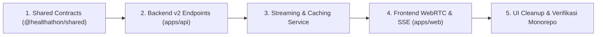

# INFERA Migration Guide: API v1 ke API v2 (All-in-One OpenAI Architecture)

Dokumen ini merupakan panduan komprehensif migrasi sistem **INFERA (Intelligent Fraud & Risk Analysis Agent)** dari arsitektur terdahulu (**v1**: multi-provider OpenRouter, polling audio ElevenLabs, dan fallback kompleks) menuju arsitektur modern berkinerja tinggi (**v2**: Native OpenAI Realtime WebRTC, SSE Streaming Token, dan Multi-Tier SHA-256 Caching).

---

## 1. Daftar Dokumen Migrasi

Folder `docs/migration/` ini terdiri dari **16 modul panduan teknis** yang tersusun secara sistematis dan kronologis dalam **5 Fase Arsitektur**:

### Fase I: Arsitektur & Paradigma Voice (Modul 01 - 05)
| Dokumen | Topik Pembahasan | Deskripsi Singkat |
| :--- | :--- | :--- |
| [**01. GPT-Live & Responses Delegation**](./01-GPT_LIVE_AND_RESPONSES_DELEGATION.md) | Full-Duplex Voice & Delegation | Arsitektur dua bagian: GPT-Live (`gpt-live-1`) suara kustom FERA untuk percakapan lisan full-duplex dan Responses Delegation (`gpt-6-astra`) untuk analitik backend. |
| [**02. Voice Agents Architecture & Evaluation**](./02-VOICE_AGENTS_ARCHITECTURE_AND_EVALUATION.md) | Paradigma Voice & Metrik Latensi | Komparasi 3 paradigma suara (GPT-Live vs Realtime vs Chained), metodologi Crawl/Walk/Run, dan profiling latensi P50/P95. |
| [**03. Managing GPT-Live Sessions & Lifecycle**](./03-MANAGING_GPT_LIVE_SESSIONS_AND_LIFECYCLE.md) | Siklus Hidup & Operasional Sesi | Seed history, transkrip delta, context compaction (128k window), forking sesi, dan unduh rekaman audio stereo WAV. |
| [**04. Migration Playbook: Realtime/Chained to GPT-Live**](./04-MIGRATION_PLAYBOOK_REALTIME_AND_CHAINED_TO_GPT_LIVE.md) | Panduan Langkah-demi-Langkah | Adaptasi event Realtime ke Live, pemisahan prompt, peredaman verbal ack, dan integrasi mitra (LiveKit/Twilio/Telnyx). |
| [**05. Live Sessions & Media Transport Reference**](./05-LIVE_SESSIONS_AND_MEDIA_TRANSPORT_REFERENCE.md) | Spesifikasi `/live/sessions` & WebRTC | Pembuatan sesi live (`POST /live/sessions`), 31 opsi suara + custom voice, primary WebSocket (`WS /v1/live/sessions`), dan kontrol audio fixture. |

### Fase II: Penalaran AI, Multi-Retrieval, & MCP Tools (Modul 06 - 09)
| Dokumen | Topik Pembahasan | Deskripsi Singkat |
| :--- | :--- | :--- |
| [**06. Responses API & Structured Outputs**](./06-OPENAI_RESPONSES_API_AND_STRUCTURED_OUTPUTS.md) | Text Generation & JSON Schemas | Pemanfaatan Responses API (`/v1/responses`), structured schemas (`zodTextFormat`), dan eliminasi halusinasi. |
| [**07. Reasoning Models & Agentic Workflows**](./07-OPENAI_REASONING_MODELS_AND_AGENTIC_FLOWS.md) | GPT-6 Reasoning & Thought Chain | Kapabilitas penalaran `gpt-6-astra`/`gpt-6-luna`, `reasoning.effort`, `reasoning.context`, dan kontinuitas multi-turn. |
| [**08. Hosted Web Search, File Search, & Temporal Grounding**](./08-WEB_SEARCH_FILE_SEARCH_AND_TEMPORAL_GROUNDING.md) | Web Search, Vector Store, & Time Now | Integrasi pencarian web domain resmi (Kemenkes/BPJS), Vector Store regulasi (Permenkes 16/2019), URL citations, dan kontrol waktu nyata (`time now`). |
| [**09. MCP & 10 Forensic Action Tools**](./09-MCP_SERVERS_AND_FORENSIC_ACTION_TOOLS.md) | Model Context Protocol & HITL | Remote MCP Server di Responses API, audit otomatis (`require_approval: never`), dan rekomendasi tindakan berizin manusia (`require_approval: always`). |

### Fase III: Protokol Jaringan & Event Stream (Modul 10 - 11)
| Dokumen | Topik Pembahasan | Deskripsi Singkat |
| :--- | :--- | :--- |
| [**10. Responses Streaming Events Reference**](./10-RESPONSES_STREAMING_EVENTS_REFERENCE.md) | Spesifikasi Lengkap SSE Streaming | Rincian seluruh event stream (`response.created`, `output_text.delta`, `reasoning.delta`, `output_item.done`, `completed`). |
| [**11. WebSocket Events & Persistent Connections**](./11-WEBSOCKET_EVENTS_AND_PERSISTENT_CONNECTIONS.md) | Koneksi Persisten & Stream Lanes | Spesifikasi client event `response.create`, multiplexing antrean via `stream_id`, prompt cache options, dan context compaction. |

### Fase IV: Implementasi Sistem INFERA API v2 & Frontend (Modul 12 - 14)
| Dokumen | Topik Pembahasan | Deskripsi Singkat |
| :--- | :--- | :--- |
| [**12. Spesifikasi API v2**](./12-API_V2_SPECIFICATION.md) | Kontrak & Endpoint API | Rincian lengkap endpoint `/api/v2/*`, server `/api/v2/mcp`, approval dispatcher, DTO Shared, dan autentikasi demo `optionalAuth`. |
| [**13. Streaming & Caching Architecture**](./13-STREAMING_AND_CACHING_ARCHITECTURE.md) | SSE & Algoritma Cache | Arsitektur Server-Sent Events, SHA-256 hashing key, penghematan biaya token hingga 70%, dan TTFT ~200ms. |
| [**14. Frontend Integration & UI Cleanup**](./14-FRONTEND_INTEGRATION_AND_CLEANUP.md) | WebRTC & Pembersihan UI | Integrasi `RealtimeVoiceService`, `OpenAiStreamService`, kartu `ActionApprovalCard`, `CitationBadge`, dan penghapusan UI clutter. |

### Fase V: Spesifikasi Terpadu & Deployment Produksi (Modul 15 - 16)
| Dokumen | Topik Pembahasan | Deskripsi Singkat |
| :--- | :--- | :--- |
| [**15. Spesifikasi Integrasi Sistem Asisten FERA**](./15-FERA_AGENT_INTEGRATION_SPECIFICATION.md) | Single Source of Truth Sistem FERA | Cetak biru terpadu seluruh lapisan sistem: model stack, suara kustom, jangkar temporal, remote MCP server, approval flow, dan verifikasi monorepo. |
| [**16. Panduan Deployment & Verifikasi**](./16-DEPLOYMENT_AND_VERIFICATION_GUIDE.md) | Env & Verification Checklist | Konfigurasi variabel lingkungan, verifikasi build monorepo, pengujian cURL `/api/v2/mcp` & suara, serta checklist produksi. |

---

## 2. Ringkasan Eksekutif: Mengapa Bermigrasi ke API v2?

### A. Problem Statement Arsitektur v1
1. **Latensi Tinggi (3.500ms - 5.000ms):**
   - Pada v1, alur percakapan audio dan teks harus melewati rantai beruntun: *User Voice -> Whisper STT -> OpenRouter LLM (menunggu full completion) -> ElevenLabs TTS synthesis -> Audio blob download -> Web Audio playback*.
   - Pengguna harus menunggu hingga 4-5 detik sebelum avatar FERA mulai berbicara.
2. **Ketergantungan Multi-Vendor:**
   - Membutuhkan minimal 3 konfigurasi API key yang berbeda (`OPENROUTER_API_KEY`, `ELEVENLABS_API_KEY`, dan `GROQ_API_KEY`).
   - Sering terjadi kegagalan transmisi bila kuota salah satu vendor habis atau terkena rate limit.
3. **Kompleksitas UI / "AI Slop" pada Frontend:**
   - Terdapat modal pengaturan suara yang berbelit-belit, form input API key ElevenLabs di sisi pengguna, dropdown voice ID ganda, dan peringatan fallback yang membingungkan juri/pengguna demo.
4. **Biaya Token Tinggi Tanpa Caching:**
   - Setiap pertanyaan yang sama dari auditor/juri (seperti *"Apa 4 modus kecurangan BPJS?"*) selalu dikirim ulang ke LLM pihak ketiga, menghabiskan biaya token dan menambah beban jaringan.

---

### B. Solusi Arsitektur v2 (Modern & Clean)

```
[ Frontend: WebRTC / SSE ]
        │
        ├── Audio WebRTC (Opus, ~300ms) ───► OpenAI Live Sessions (POST /live/sessions)
        │                                         ▲
        │                                         │ SDP Offer/Answer Handshake
        │                                         ▼
        └── SSE Token Stream (~200ms TTFT) ──► Express API v2 (/api/v2/ai/chat/stream)
                                                  │
                                                  ├── Cache Hit (0ms, $0) ◄── [ SHA-256 CacheService ]
                                                  │
                                                  └── Cache Miss ───────────► OpenAI gpt-6-luna / gpt-6-astra
```

1. **Sub-Second Realtime Voice via WebRTC (~300ms End-to-End):**
   - Menggunakan endpoint resmi **OpenAI Live Sessions** (`POST /live/sessions`) atau Realtime GA (`POST /v1/realtime/client_secrets`) yang melakukan negosiasi SDP Offer/Answer.
   - Browser melakukan koneksi langsung via WebRTC peer connection ke OpenAI. Audio masuk dan keluar berupa stream Opus dengan deteksi Voice Activity Detection (VAD) otomatis di server OpenAI.
2. **Mandatory SSE Token Streaming (~200ms TTFT):**
   - Seluruh interaksi teks menggunakan protokol standard Server-Sent Events (`POST /api/v2/ai/chat/stream`).
   - Teks muncul kata demi kata secara instan tanpa blocking, memberikan pengalaman pengguna yang sangat responsif.
3. **Multi-Tier SHA-256 Caching:**
   - Pertanyaan yang berulang disimpan di in-memory / persistent cache dengan kunci hash SHA-256 deterministik.
   - Cache hit disajikan secara instan dengan *simulated streaming* (~8ms chunking) tanpa memanggil API OpenAI sama sekali, memangkas biaya hingga **70%** pada sesi demo.
4. **Pembersihan Antarmuka (Anti-AI Slop):**
   - Seluruh pengaturan suara eksternal, form kunci API ElevenLabs, dan dropdown fallback dihapus dari UI. Pengguna langsung menikmati interaksi avatar FERA cerdas tanpa distraksi teknis.
5. **Zero-Friction Authentication (`optionalAuth`):**
   - Juri atau penguji demo dapat langsung mencoba fitur deteksi kecurangan dan voice avatar tanpa harus terhalang oleh *401 Unauthorized*.

---

## 3. Matriks Perbandingan Arsitektur

| Parameter | Arsitektur v1 (Legacy) | Arsitektur v2 (Current) | Peningkatan |
| :--- | :--- | :--- | :--- |
| **Penyedia LLM Utama** | OpenRouter (Multiple routing) | OpenAI Direct (`gpt-6-luna` & `gpt-6-astra`) | Konsistensi & Reliabilitas Tinggi |
| **Model Suara & TTS** | ElevenLabs Flash v2.5 (HTTP polling) | OpenAI Live WebRTC (`gpt-live-1` suara kustom FERA `voice_6ae35f4fc2388191a0b2f21060b4e417`) | Latensi turun dari ~4.5s ke ~300ms |
| **Tool Calling & MCP** | Sederhana via client manual | INFERA Remote MCP Server + 10 Forensic Tools + Two-Phase HITL Action Proposals | Standar Model Context Protocol & Governed Action Cards |
| **Protokol Chat Teks** | Blocking JSON HTTP Request | Server-Sent Events (SSE) Streaming | TTFT turun dari ~2.5s ke ~200ms |
| **Mekanisme Caching** | Tidak ada pada streaming | SHA-256 Multi-tier Memory Caching | Hemat biaya token hingga 70% |
| **Sinkronisasi Bibir (Lip-Sync)** | Perhitungan amplitudo audio offline | RMS AnalyserNode 60 FPS real-time Web Audio | Gerakan avatar jauh lebih natural |
| **Beban Konfigurasi User** | Meminta API Key ElevenLabs di UI | Zero-config (Cukup `OPENAI_API_KEY` di server) | Bebas friksi bagi juri lomba |

---

## 4. Roadmap & Status Implementasi



- [x] **Milestone 1: Kontrak Data & Definisi Tools**
  - Tipe `RealtimeSessionResponseDTO`, `RealtimeVoiceName`, `RealtimeSessionOptions`.
  - Definisi 10 Tools Forensik INFERA (`INFERA_TOOL_DEFINITIONS`).
  - Prefix routing `API_V2_PREFIX = '/api/v2'`.
- [x] **Milestone 2: Backend Services v2**
  - `openai-realtime.service.ts` terhubung ke endpoint GA OpenAI.
  - `openai-chat.service.ts` mendukung chat completion dan SSE streaming.
  - Route controller `/api/v2/voice` dan `/api/v2/ai`.
- [x] **Milestone 3: Streaming & Caching Optimization**
  - Integrasi `cacheService.hashKey` pada SSE chat stream.
  - Fallback simulasi stream pada cache hit (0ms upstream latency).
  - Middleware `optionalAuth` untuk akses instan juri/tamu.
- [x] **Milestone 4: Integrasi Frontend**
  - `RealtimeVoiceService.ts` untuk koneksi WebRTC audio dua arah dan deteksi RMS bibir 60 FPS.
  - `OpenAiStreamService.ts` untuk konsumsi token SSE secara live.
- [x] **Milestone 5: Dokumentasi Lengkap & Verifikasi**
  - Dokumentasi 16 modul migrasi selesai di folder `docs/migration/` dalam 5 fase terstruktur.
  - Struktur arsitektur disinkronkan dengan fakta teknis resmi OpenAI.
